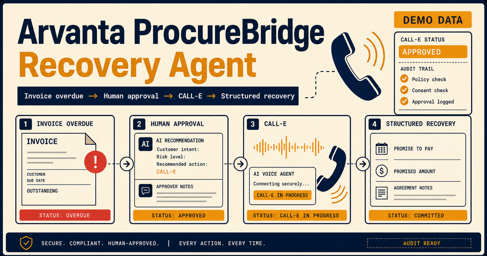

# Arvanta ProcureBridge Recovery Agent

> Every customer, invoice, metric, transcript, call, and outcome in this repository is **Demo Data**. The default provider is `MockCallProvider`; no real customer is contacted.



## 1. Project overview

Arvanta ProcureBridge Recovery Agent is a judge-ready SaaS prototype for overdue-invoice recovery. It connects a prioritized collection queue to AI pre-call intelligence, explicit human approval, call-policy guardrails, a CALL-E provider boundary, structured post-call review, synchronized promise/dispute/follow-up records, and an auditable event history.

The full demo runs without API keys, a database, or external network access.

## 2. Problem

Receivables teams often work from fragmented queues, notes, calls, and spreadsheets. Customer conversations contain operational commitments, disputes, and callback requests, but those details are manually re-entered and are difficult to audit. Voice automation alone does not solve the risk: an autonomous call must respect consent, contact policy, disclosure requirements, negotiation limits, and human ownership of financial decisions.

## 3. Solution

ProcureBridge turns a collection call into a controlled workflow. It prioritizes overdue invoices, prepares a scenario-specific brief, locks the call behind approval and eight policy checks, runs a provider-isolated conversation, extracts a structured result, and requires a human disposition before any downstream recovery object is created.

## 4. Core workflow

`Collection Queue → Pre-call Brief → Human Approval & Guardrails → CALL-E / Mock Call → Transcript → Structured Result → Human Review → Promise / Dispute / Follow-up → Audit Log`

The **Start 2-Minute Demo** guide uses PT Sinar Jaya Retail and restores the previous browser-store snapshot when Judge Demo Mode is exited.

## 5. Screenshots

The deployed prototype contains presentation-ready views for:

- landing and judge access;
- Collection Queue and AI pre-call briefing;
- Human Approval and guardrail decisions;
- simulated CALL-E transcript console;
- structured result review and downloadable evidence;
- Promise Tracker, Dispute Center, Dashboard, and Audit Log;
- [architecture](./docs/architecture.md) and technical notes.

The social preview above uses the same navy, cream, amber, strong-border visual language as the product.

## 6. Demo scenarios

| Scenario | Demo customer | Structured outcome |
| --- | --- | --- |
| Promise to Pay | PT Sinar Jaya Retail | Rp7,500,000 promised for 10 Aug 2026; follow-up 11 Aug |
| Invoice Dispute | CV Maju Teknik | Quantity mismatch dispute; collection call blocked |
| Failed Contact | PT Karya Distribusi | PIC unavailable; policy-checked follow-up scheduled |

Simulation speeds are Real-time (about 30–45 seconds), Fast Demo (about 12–18 seconds), and Instant Result. Judge Demo Mode defaults to Fast Demo.

## 7. Architecture

The multi-page Next.js application consumes a versioned browser store. Pure domain functions own approvals, guardrails, lifecycle transitions, result review, synchronized downstream updates, and audit entries. `CallProvider` isolates the UI from `MockCallProvider` and the integration-ready `CalleProvider`. Webhooks are processed through a validation, signature, idempotency, ordering, and audit boundary. Supabase remains optional.

See [docs/architecture.md](./docs/architecture.md) and the in-app `/architecture` page.

## 8. Tech stack

- Next.js 15 App Router / vinext
- React 19 and TypeScript
- Tailwind CSS plus product-specific CSS
- Vitest
- versioned `localStorage`
- optional PostgreSQL/Supabase SQL and repository adapter
- Cloudflare-compatible Sites deployment output

## 9. Quick start

Requirements: Node.js 22.13 or newer.

```bash
npm install
npm run dev
```

Open the URL printed by the development server. No environment file is required for the complete mock demo.

```bash
npm run typecheck
npm run lint
npm run test
npm run build
```

## 10. Environment variables

Copy `.env.example` to `.env.local` only when enabling optional services.

| Variable | Purpose |
| --- | --- |
| `NEXT_PUBLIC_APP_URL` | Canonical deployed application URL |
| `CALLE_API_URL` | CALL-E REST base URL |
| `CALLE_API_KEY` | Server-only CALL-E bearer token |
| `CALLE_AGENT_ID` | Configured CALL-E voice-agent ID |
| `CALLE_WEBHOOK_SECRET` | Server-only webhook verification secret |
| `CALLE_WEBHOOK_SIGNATURE_HEADER` | Generic placeholder signature-header name until CALL-E confirms its contract |
| `SUPABASE_URL` | Optional Supabase project URL |
| `SUPABASE_ANON_KEY` | Reserved for an optional client integration |
| `SUPABASE_SERVICE_ROLE_KEY` | Server-only repository credential |

Never prefix server secrets with `NEXT_PUBLIC_`.

## 11. CALL-E provider integration

The contract lives in `lib/calle/types.ts`; provider selection lives in `lib/calle/client.ts`. Missing CALL-E configuration selects `MockCallProvider`. Complete configuration selects `CalleProvider`. A failed live `createCall` is shown as a real provider failure and offers an explicit **Switch to Demo Call** action. It is never relabeled as a successful live call.

Until the official CALL-E contract is supplied, the adapter assumes:

- `POST /calls` creates a call;
- `GET /calls/{id}` returns call status;
- `POST /calls/{id}/end` ends a call;
- `GET /calls/{id}/transcript` returns transcript segments;
- authentication uses a server-only bearer token.

Update only `CalleProvider` request/response mapping when the official contract is available; UI components remain provider-agnostic.

## 12. Webhook events

`POST /api/calle/webhook` accepts `call.started`, `call.connected`, `transcript.updated`, `call.completed`, `call.failed`, and `analysis.completed`. Each event requires an event ID, call ID, type, timestamp, object payload, and valid signature boundary. The handler deduplicates IDs, acknowledges but ignores stale events, invokes audit callbacks, and returns safe errors without reflecting payloads or secrets.

The current verifier is a generic `HMAC-SHA256` placeholder over the exact raw request body, using a configurable placeholder header. It uses timing-safe comparison but is **not** claimed to match CALL-E. Replace the algorithm, canonicalization, and header only after the official CALL-E signing contract is confirmed.

## 13. Supabase optional setup

Apply [supabase/schema.sql](./supabase/schema.sql) through the official migration pipeline of the target Supabase project. Explicit repository mappers convert domain camelCase to database snake_case, validate enums/nulls, and safely convert PostgreSQL numeric strings. The schema includes constraints, indexes, RLS, server-only access, append-only audit intent, and durable webhook event state. The demo does not import Supabase SDK and does not require a database.

## 14. Testing

```bash
npm run test
npm run test:coverage
```

Automated tests cover approvals, every browser and server call guardrail, call lifecycle, idempotent result review, all three outcomes, persistence/reset, repository mapping, cross-page domain synchronization, webhook validation/deduplication/ordering, provider timeout/error safety, simulation speeds, Judge Demo Mode, health output, metadata hygiene, documentation path hygiene, and masked demo reports. Coverage thresholds are moderate and limited to critical domain, reducer, persistence, webhook, and mapper files.

GitHub Actions runs `npm ci`, typecheck, lint, tests, coverage, and the production build for pushes and pull requests to `main`. Tests are offline and never call the real CALL-E API. Live telephony, an activated Supabase project, database migrations, authentication, and multitenant integration tests remain intentionally inactive.

## 15. Production gaps

- The official CALL-E API request/response contract has not been confirmed.
- The official CALL-E webhook HMAC, header, and canonical-body rules have not been confirmed.
- Authentication, tenant isolation, and production authorization are not active.
- Supabase mappers, repository adapters, and SQL are a foundation only; the demo does not activate them.
- Live telephony must not be enabled until server authorization uses production customer, approval, dispute, and call-history repositories.

## 16. Security and guardrails

The call is blocked when approval is incomplete, consent is invalid, Do Not Contact is active, calling time is outside policy, the customer was already called today, an open dispute exists, phone/invoice data is invalid, or AI disclosure is not approved. Sensitive numeric patterns are masked. Results below confidence policy or incomplete promises require Human Review. Important financial data changes only after explicit result approval.

See [docs/security.md](./docs/security.md).

## 17. Simulated components

- telephony, voice synthesis, recording playback, and transcript streaming when mock is active;
- sentiment, intent, entities, confidence, and pre-call intelligence;
- seeded customer, invoice, history, activity, and dashboard metrics;
- payment reconciliation and `actualAmount` updates;
- background follow-up execution;
- production authentication and multitenancy;
- Supabase persistence until explicitly activated.

All simulated surfaces are labeled **Demo Data** or **Simulation**.

## 18. Production roadmap

1. Validate the official CALL-E request, event, signing, retry, and media contracts.
2. Activate Supabase through reviewed migrations, tenant-safe RLS, backups, and monitoring.
3. Add enterprise identity, tenant isolation, retention/deletion policy, consent provenance, and secret rotation.
4. Integrate accounting invoices and payment reconciliation through idempotent, approval-gated commands.
5. Add durable jobs, dead-letter handling, observability, multilingual voice, configurable policies, and production analytics.

Judge materials: [final submission package](./docs/submission-package/project-summary.md), [submission copy](./docs/submission-package/submission-copy.md), [90-second script](./docs/submission-package/demo-script-90s.md), [three-minute script](./docs/submission-package/demo-script-3min.md), [recording shot list](./docs/submission-package/recording-shot-list.md), [screenshot plan](./docs/submission-package/screenshot-plan.md), [judge instructions](./docs/submission-package/judge-instructions.md), [technical proof](./docs/submission-package/technical-proof.md), and [risk register](./docs/submission-package/risk-and-limitations.md).

Public judge pages: [Submission Hub](https://arvanta-procurebridge-recovery.valentansuri123.chatgpt.site/submission), [Architecture](https://arvanta-procurebridge-recovery.valentansuri123.chatgpt.site/architecture), [Technical Notes](https://arvanta-procurebridge-recovery.valentansuri123.chatgpt.site/technical-notes), and [Health](https://arvanta-procurebridge-recovery.valentansuri123.chatgpt.site/api/health).
